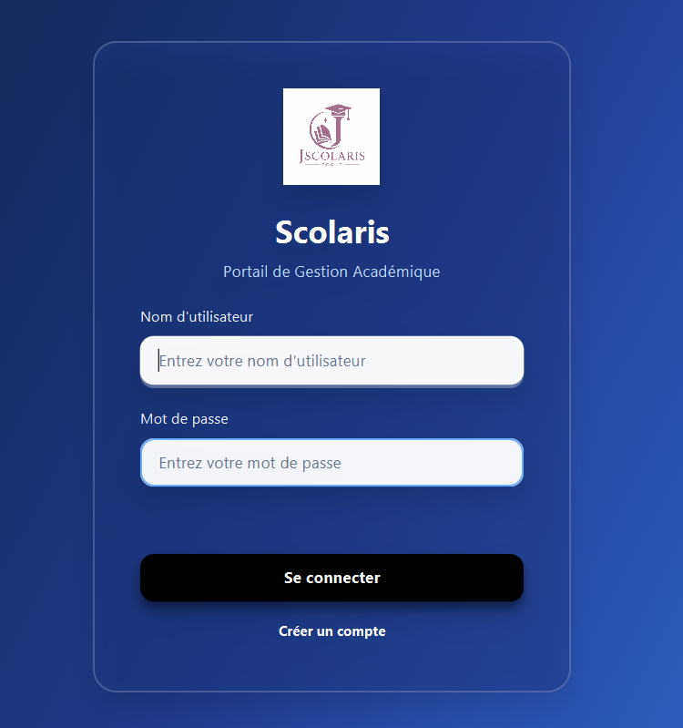
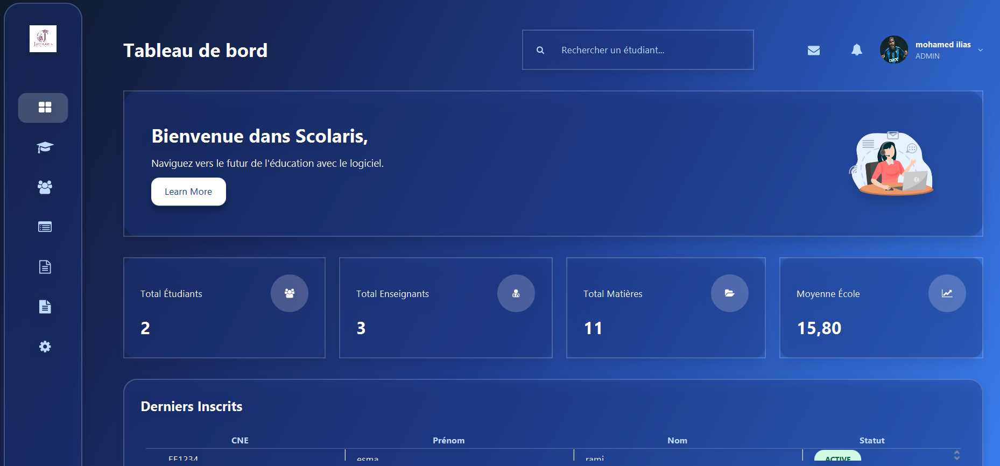
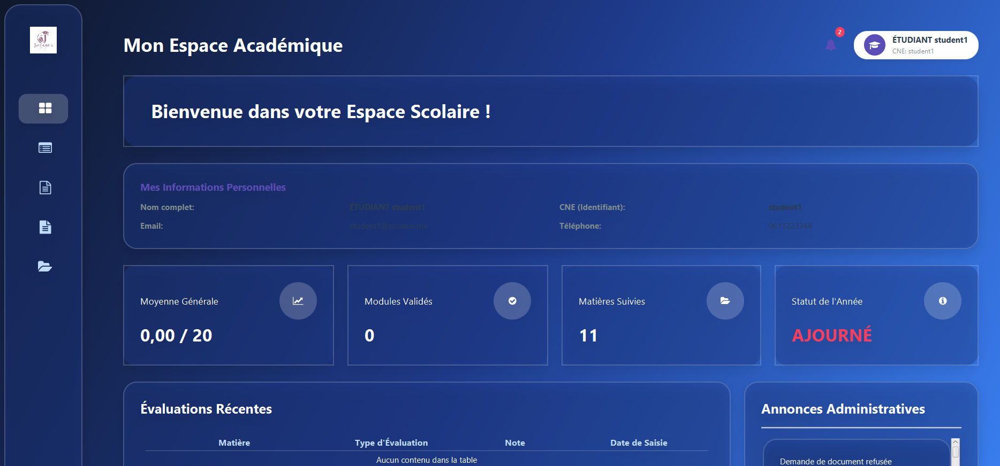
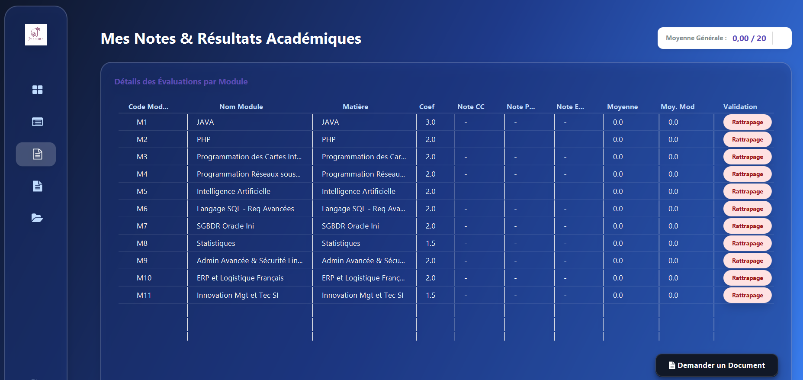
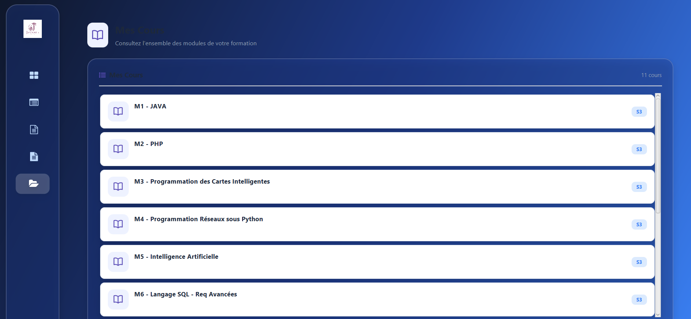
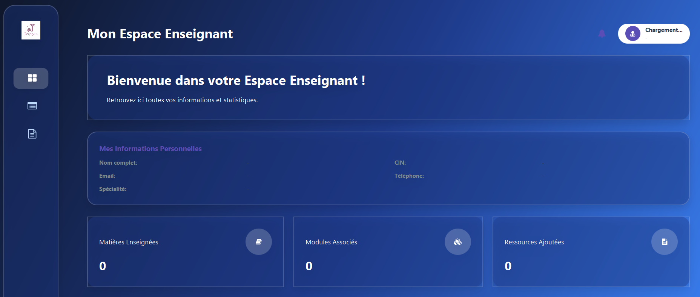
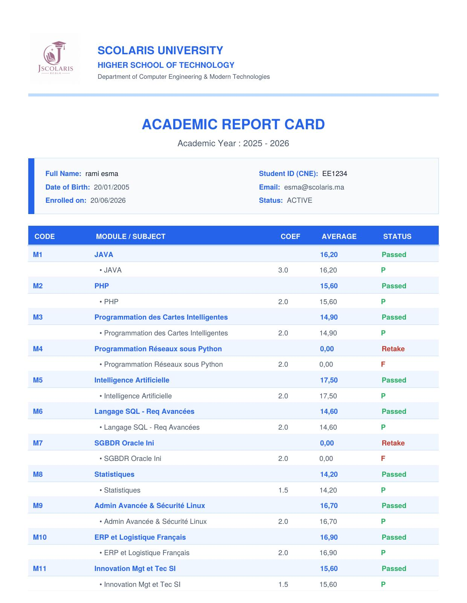
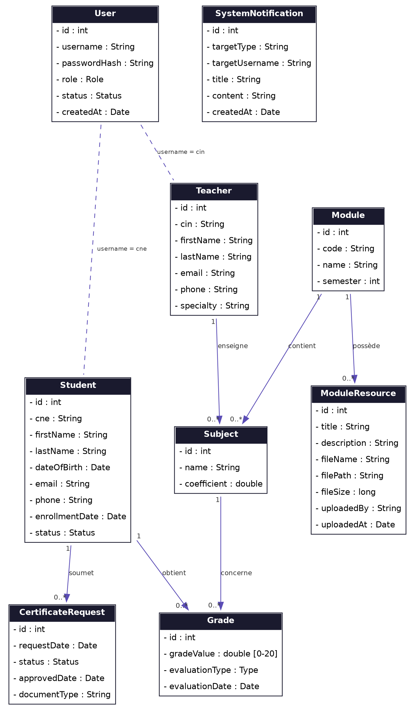

# Alma Campus

**Alma Campus** (internal codename *Scolaris*) is a desktop school management system built with **Java**, **JavaFX** and **MySQL**. It gives administrators, teachers and students a single application to manage academic life: students, teachers, modules, subjects, grades, course resources and administrative certificates.

The project follows a layered **MVC + DAO** architecture to keep the user interface, business logic and data access cleanly separated.

---

## Features

### Administrator
- Secure login with role-based access (Admin / Teacher / Student)
- Dashboard with key statistics and notifications
- Manage students and teachers (create, edit, delete, search)
- Manage modules and subjects, and assign teachers to subjects
- User account management (activate / deactivate accounts)
- Review and approve or reject certificate requests
- Import / export data (CSV, Excel) and PDF generation

### Teacher
- Personal home page with assigned subjects
- Enter and update student grades (continuous assessment and exams)
- Upload course resources (PDFs, documents) for each module
- Receive system notifications

### Student
- Personal dashboard and profile page
- View grades and averages per subject and module
- Browse modules and download course resources
- Request school certificates and download approved certificates as PDF
- Receive notifications (e.g. certificate approved)

### Security
- Passwords hashed with **BCrypt** (never stored in plain text)
- Database credentials kept out of source control (`db.properties`)
- Connection pooling with **HikariCP**

---

## Screenshots

> The user interface is in French, and **Scolaris** was the project's working name, so it appears throughout the screenshots.

### Login


*Secure sign-in for administrators, teachers and students.*

### Admin dashboard


*Overview of students, teachers, subjects and the school-wide average.*

### Student and teacher pages

| Student dashboard | Student grades |
|:---:|:---:|
|  |  |
| *Personal info, average and recent evaluations* | *Grades and validation status per module* |
| **Student courses** | **Teacher dashboard** |
|  |  |
| *List of modules for the student's program* | *Assigned subjects, modules and resources* |

### Design

| PDF report card | Class diagram |
|:---:|:---:|
|  |  |
| *Report card generated as a PDF* | *Domain model (User, Student, Teacher, Module, Subject, Grade, ...)* |

---

## Tech Stack

| Layer | Technology |
|-------|------------|
| Language | Java 21 |
| User interface | JavaFX 21 (FXML + CSS), FontAwesomeFX |
| Database | MySQL / MariaDB |
| Data access | JDBC, HikariCP connection pool |
| Architecture | MVC + DAO (Model, View, Controller, Service, DAO layers) |
| Security | jBCrypt password hashing |
| Documents | OpenPDF (PDF), Apache POI (Excel), OpenCSV |
| Logging | SLF4J + Logback |
| Build | Maven (with Maven Wrapper) |

### Project structure

```
src/main/java/com/scolaris/
├── MainApp.java        # JavaFX entry point
├── controller/         # JavaFX controllers (View logic)
├── service/            # Business logic
├── dao/                # DAO interfaces
│   ├── impl/           # JDBC implementations
│   └── db/             # Database connection (HikariCP)
├── model/              # Domain entities
├── exception/          # Custom exceptions
└── util/               # Helpers (dialogs, cache, seeding, ...)
src/main/resources/
├── fxml/               # Views
├── css/                # Styles
├── images/             # Images and icons
└── database/schema.sql # Minimal schema
scolaris_db.sql         # Full database dump with sample data
```

---

## Getting Started

### Prerequisites
- **JDK 21** or newer
- **MySQL 8** or **MariaDB 10.4+** (e.g. via XAMPP)
- Maven is optional: the project ships with the Maven Wrapper (`mvnw` / `mvnw.cmd`)

### 1. Clone the repository
```bash
git clone https://github.com/ilias-lamtaouab/alma-campus.git
cd alma-campus
```

### 2. Create the database
Create a database named `scolaris_db` and import the dump:
```bash
mysql -u <your_user> -p -e "CREATE DATABASE scolaris_db CHARACTER SET utf8mb4 COLLATE utf8mb4_unicode_ci;"
mysql -u <your_user> -p scolaris_db < scolaris_db.sql
```
(You can also import `scolaris_db.sql` with phpMyAdmin.)

### 3. Configure the database connection
Copy the example configuration and fill in your own credentials:
```bash
cp db.properties.example db.properties      # Windows: copy db.properties.example db.properties
```
```properties
db.url=jdbc:mysql://localhost:3306/scolaris_db?useSSL=false&serverTimezone=UTC&allowPublicKeyRetrieval=true
db.username=your_db_username
db.password=your_db_password
db.pool.size=10
```
`db.properties` is listed in `.gitignore` and must never be committed.
The application looks for it in the working directory (project root). You can also point to another file with `-Ddb.config=/path/to/db.properties`.

### 4. Run the application
```bash
./mvnw clean javafx:run        # Linux / macOS
mvnw.cmd clean javafx:run      # Windows
```
On Windows you can also double-click `run.bat`.

### Demo accounts
The sample database and the built-in seeder use these **demo** credentials:

| Role | Username | Password |
|------|----------|----------|
| Admin | `admin` | `admin123` |
| Teacher | `AB1234` | `teacher123` |
| Student | `EE1234` | `student123` |

All sample teacher accounts use `teacher123` and all sample student accounts use `student123`. Change them before any real use.

---

## Authors

- **Mohamed Ilias Lamtaouab**
- **Abderrahman Tyoubi**

---

## License

This project was developed for academic purposes. All rights reserved by the authors unless a license file is added.
